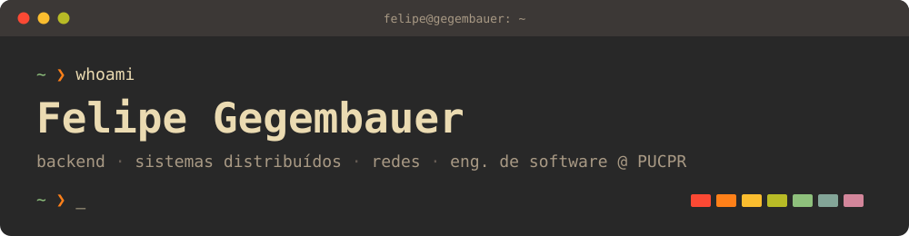

  

Desenvolvedor backend e estudante de Engenharia de Software na PUCPR. Trabalho principalmente com Node.js e TypeScript. Nos projetos pessoais, foco em sistemas distribuídos, redes e correção: determinismo, idempotência e testes.

  
  
  
  

  

